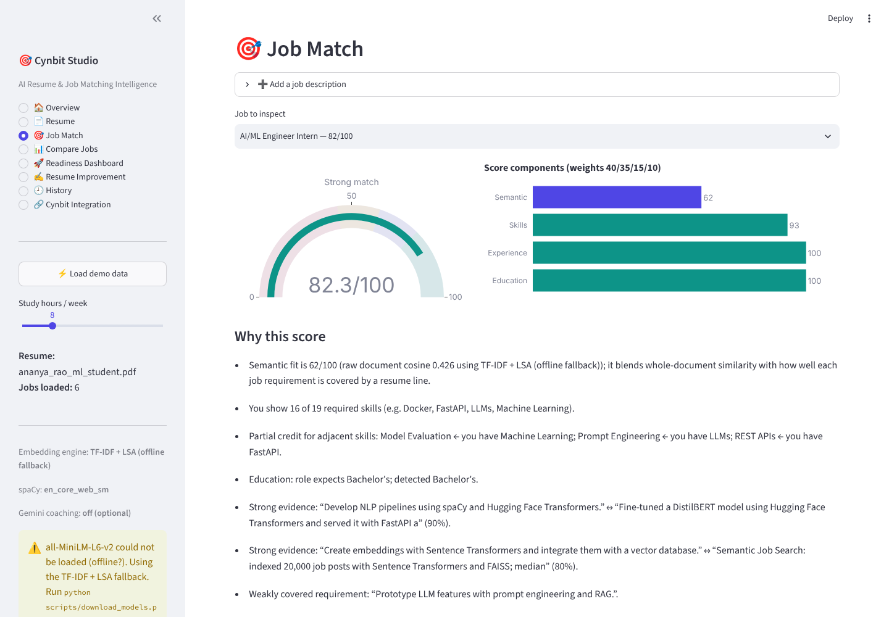
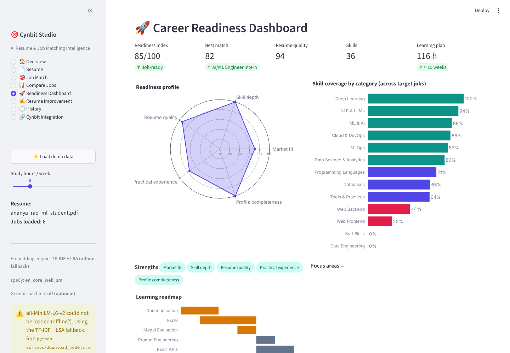

# 🎯 Cynbit Studio – AI Resume & Job Matching Intelligence

> Prototype built for the **Cynbit Technologies AI/ML Engineer Intern assessment**.
> Helps students find the jobs they fit best, see exactly which skills they're missing, and plan how to close the gap.

Cynbit Studio parses a resume (PDF / DOCX / TXT), understands one or more job descriptions, and computes an
**explainable semantic match score** with **Sentence Transformers (`all-MiniLM-L6-v2`)**, spaCy and a curated skill
taxonomy. It then ranks jobs, finds missing skills, builds a personalised learning roadmap, scores resume quality and
shows a career-readiness dashboard. Everything runs locally; Gemini is optional.




> Verification status: see [`TEST_RESULTS.md`](TEST_RESULTS.md).

---

## ✨ Features

| # | Feature | Where |
|---|---------|-------|
| 1 | PDF/DOCX/TXT upload & parsing (PyMuPDF, python-docx incl. tables) | `parser.py`, 📄 Resume |
| 2 | Skill, experience (date-range merge), education/CGPA, section & contact extraction | `skills.py`, `extractor.py` |
| 3 | Job description analysis: required vs preferred skills, seniority, min years, degree, key phrases | `jd_analyzer.py` |
| 4 | Semantic matching with `all-MiniLM-L6-v2` (document + requirement-level alignment) | `embeddings.py`, `matcher.py` |
| 5 | Match score with explanations and per-requirement evidence | 🎯 Job Match |
| 6 | Missing / related (partial-credit) skill identification | `matcher.py` |
| 7 | Personalised learning plan: priority, hours, week-by-week roadmap, free resources, project ideas | `recommender.py` |
| 8 | Multi-job comparison, ranking table, skill-demand heatmap, CSV export | `ranking.py`, 📊 Compare Jobs |
| 9 | Career readiness dashboard (index, radar, category coverage, PDF report) | `readiness.py`, 🚀 Dashboard |
| 10 | Resume improvement suggestions (impact, verbs, weak phrases, passive voice via spaCy, keywords…) | `suggestions.py` |
| + | SQLite history (privacy-preserving), optional Gemini coaching with PII redaction, CLI | `database.py`, `gemini.py` |

## 🧠 How the score works (no fake numbers)

```
overall = 0.40·semantic + 0.35·skills + 0.15·experience + 0.10·education

semantic   = ½·cal(cos(doc_emb(resume), doc_emb(job)))            # whole-document similarity
           + ½·mean_i  cal(max_j cos(req_i, resume_line_j))         # each requirement's best evidence
skills     = Σ w·credit / Σ w        w = 2 required, 1 preferred; credit = 1 matched, 0.5 related, 0 missing
experience = min(1, detected_years / required_years)               # overlapping date ranges merged
education  = degree level vs. requirement
```

* `doc_emb` = mean of normalised MiniLM embeddings of ~90-word chunks (MiniLM truncates at 256 word-pieces).
* `cal()` linearly maps the model's raw cosine range to 0–1 so scores are interpretable; raw cosine is shown in the UI.
* "Related" credit comes from taxonomy relations (e.g. TensorFlow → PyTorch) and, with MiniLM, from embedding
  similarity between skill names within the same category.
* **Offline fallback:** if the MiniLM model can't be downloaded, the app automatically switches to a
  TF-IDF + LSA engine with skill-concept normalisation (still real cosine similarity) and shows a warning.

## 🚀 Setup (VS Code, Windows/macOS/Linux)

Requires **Python 3.10 – 3.13**.

```bash
# 1. Open the folder in VS Code, then in the terminal:
python -m venv .venv
# Windows:  .venv\Scripts\activate        macOS/Linux:  source .venv/bin/activate

# 2. Install dependencies (includes the spaCy en_core_web_sm model)
pip install -r requirements-dev.txt
#   CPU-only PyTorch (smaller download) — optional, run BEFORE the line above:
#   pip install torch --index-url https://download.pytorch.org/whl/cpu

# 3. Pre-download all-MiniLM-L6-v2 (~90 MB, one time; needs internet)
python scripts/download_models.py

# 4. (Optional) enable Gemini coaching
cp .env.example .env      # then set GEMINI_API_KEY=...   (Windows: copy .env.example .env)

# 5. Run the app
streamlit run app.py
```

Open http://localhost:8501 and click **⚡ Load demo data** in the sidebar for an instant walkthrough.

In VS Code you can also use **Run and Debug → "Streamlit: Cynbit Studio"** (see `.vscode/launch.json`).

### CLI

```bash
python scripts/cli.py samples/resumes/ananya_rao_ml_student.pdf samples/jobs
```

### Tests

```bash
pytest                      # all tests (MiniLM test auto-skips if the model isn't cached)
pytest -m transformer       # only the Sentence-Transformers test
CYNBIT_EMBEDDING_BACKEND=tfidf pytest   # force the offline engine
```

## 🗂️ Project structure

```
cynbit-studio/
├── app.py                     # Streamlit UI (8 pages)
├── src/cynbit/
│   ├── __init__.py            # analyze(): one-call pipeline
│   ├── config.py              # settings from env/.env
│   ├── parser.py              # PDF/DOCX/TXT -> clean text
│   ├── nlp.py                 # spaCy loader, sentences, NER, noun chunks, passive voice
│   ├── skills.py              # taxonomy-driven skill extraction
│   ├── extractor.py           # resume profile: sections, experience, education, contact, PII redaction
│   ├── jd_analyzer.py         # job description understanding
│   ├── embeddings.py          # MiniLM engine + TF-IDF/LSA fallback
│   ├── matcher.py             # scoring + explanations
│   ├── ranking.py             # multi-job ranking, skill matrix
│   ├── recommender.py         # learning plan
│   ├── suggestions.py         # resume improvement + quality score
│   ├── readiness.py           # career readiness index
│   ├── database.py            # SQLite history (no raw resume text stored)
│   ├── gemini.py              # optional LLM coaching
│   ├── charts.py              # Plotly figures
│   └── report_export.py       # per-candidate PDF report
├── data/                      # skills_taxonomy.json, learning_resources.json
├── samples/                   # synthetic resumes (PDF/DOCX/TXT) + job descriptions
├── docs/                      # AI_Opportunity_Report.pdf, Technical_Approach_Report.pdf
├── scripts/                   # generate_samples.py, generate_reports.py, download_models.py, cli.py
├── tests/                     # pytest suite incl. headless Streamlit AppTest
├── requirements.txt / requirements-dev.txt / pyproject.toml / pytest.ini
├── .env.example / .gitignore / .streamlit/config.toml / .vscode/
└── .github/workflows/ci.yml   # GitHub Actions: install + pytest
```

## 🔒 Privacy & security

* No secrets in the repo — `.env` is git-ignored; `.env.example` holds placeholders only.
* The SQLite history stores a SHA-256 **fingerprint** of each resume plus scores, never the raw text.
* Emails, phone numbers and URLs are redacted before any text is sent to Gemini.
* All sample people and companies are fictional (`example.com`, `555` numbers).

## 🔗 Integration with Cynbit Studio (future)

The AI logic is a framework-independent package, so it can move from this Streamlit prototype into a production
product with minimal change:

1. **API layer** – wrap `cynbit.analyze()` in FastAPI (`/parse`, `/match`, `/rank`, `/recommend`), containerise with Docker.
2. **Embeddable widget** – a "Resume Match" component on Cynbit Studio web pages / client portals, authenticated with JWT/SSO.
3. **Scale** – PostgreSQL + pgvector storing job embeddings once; nightly job-feed indexing; matching in milliseconds.
4. **Learn from outcomes** – calibrate the score weights on recruiter shortlist decisions.
5. **GenAI layer** – optional Gemini coaching, cover-letter drafts and interview prep (PII redaction already built in).

Details and business case: `docs/AI_Opportunity_Report.pdf`. Architecture and evaluation: `docs/Technical_Approach_Report.pdf`.

## ⚠️ Limitations

* Skill extraction is taxonomy-based (90 skills, ~430 surface forms): unseen niche tools aren't detected until added to `data/skills_taxonomy.json`.
* Scanned/image-only PDFs need OCR (not included); the app tells the user to upload a text PDF/DOCX.
* Score calibration constants are heuristic; they should be tuned on labelled resume–job pairs before production use.
* Scores are guidance for students, not an automated hiring decision.

## License

MIT
